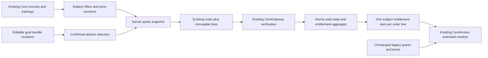

# T1.2 — Commerce architecture

Date: **2026-11-20**. Documentation only. The one-time subject/bundle/12-month model, **490,000 Toman (4,900,000 IRR) initial price per subject**, and distinct-subject tiers **0/5/10/15/20/25%** for one through six subjects are **APPROVED**; detailed rounding, benefit/term, renewal, refund, preset and quote/checkout policies remain pending in [Phase 1 decisions](PHASE_1_DECISION_REGISTER.md). No source, configuration, checkout, payment or database behavior changed.

## Current architecture — directly inspected source

Backend paths below are confined to `D:/Lerona/Backend/backend/Cent.Module`; frontend paths are relative to `D:/Lerona/itatest`. Evidence is local source, not deployed-state certification. Historical [Phase 7A handoff](docs/refinement/PHASE_7_COMMERCE_API_HANDOFF.md) and [revised audit](MONETIZATION_AND_ENTITLEMENTS_AUDIT_REVISED.md) corroborate it.

| Area | Verified implementation | Target delta |
| --- | --- | --- |
| Catalog | `CentContent.cs` GET `/catalog`: published trainings, active products; subscription or product linked to published training | Explicit subject offer and publication/benefit scope; six-subject readiness; retain legacy catalog reader |
| Subject mapping | `CurriculumEntities.cs`: CentCourse.Code → optional TrainingId. `CentCurriculumImporter.cs` creates stable trainings for five subjects; no product-price seed in importer | Reuse course/training relationship; explicit new Reading identity and subject offer mapping; arbitrary training is not automatically a whole-subject product |
| Products | `Entities.cs` CentProduct: Title, Kind, TrainingId, PriceRial, DurationDays, Active | Versioned subject offer and term/benefit revision; new sales are not TRAINING-permanent or SUBSCRIPTION |
| Constraints | `CentDbContext.cs`: TRAINING requires training and null duration; SUBSCRIPTION has no training and duration 1–366 days; positive price | Additive new product representation; do not put 12 months into legacy DurationDays or relax historical meaning silently |
| Admin prices | `CentAdmin.cs` PUT `/admin/products/{id}` permits integer rial price >0 and ≤1,000,000,000,000; edits title/price/duration/active; blocks kind/training changes after any order | Versioned price/tier/offer activation and audit; current admin has no progressive-discount/preset editor |
| Checkout | `CentPayments.Checkout`: ProductId+RequestId, authenticated owner; unique user/request; current product eligibility; saves title/kind/training/duration/amount/provider snapshot | One canonical selected subject set, server quote and itemized immutable lines; one order/payment for the bundle |
| Payment initiation | CentGateway chooses stored MOCK/SANDBOX/ZARINPAL; server amount in IRR; per-user PurchaseVersion write serializes authority creation | Reuse provider adapter, order identity and locking concept; do not replace with client prices or multiple bundle payments |
| Verification | Stored authority/amount/provider; success 100/101 plus valid reference in inspected adapter; callback `Status=OK` triggers verification only | Keep verification server-side; browser redirect/URL/local state never grants access. No external provider behavior certified here |
| Settlement | Recheck paid state under per-user transaction; paid timestamp/reference, event and one grant commit together | For new-format orders, all order lines and subject items commit atomically with one paid state; retries never duplicate terms |
| Grants | CentEntitlement has one unique OrderId, optional TrainingId, Kind, start/end/revocation | Keep one aggregate per order; add independent subject items. Several legacy grant rows per bundle would violate uniqueness |
| Expiry | CentAccess.CanRead uses published training, StartsAt≤now, null or ExpiresAt>now, non-revoked; subscription scope respects IncludedInSubscription | Extend same resolver for subject items; preserve legacy resolver. New subject terms finite; exact lifecycle pending |
| Repurchase | Checkout/resume without authority rejects any non-revoked TRAINING grant, even expired; frontend ownsTraining accepts only permanent null-expiry grants | Finite-subject purchase/renewal decisions must use subject-item intervals, not these permanent guards |
| Benefits | Source lessons/pages/progress/note editing require document access; owner note listing remains separate. Simulator start/submit require active subscription; diagnostic/Practice not generally gated by purchased subject | Define explicit future benefits and full-mock admission; do not silently change existing diagnostic/Practice or legacy simulator handling |
| History | Owner latest 200 orders; admin latest 500, no dedicated order-detail GET/pagination in inspected code; library lists historical grants and separately readable IDs | Add owner detail/pagination projections and itemized lines/terms; paid status remains distinct from current content access |
| Client | `services/commerce.ts`, `useCommerceAccess.ts`, `usePaymentCooldown.ts`, `pages/CommercePages.tsx`, `components/CommerceUI.tsx`: persisted account/product UUID, same-order recovery, IRR display, retry-after, session-change guards, boundary/focus access refresh | Preserve recovery/trust rules; new cart/quote identity includes canonical subjects/intent/policy; replace permanent/subscription offer assumptions only in later scoped implementation |
| Refunds | Admin grant revocation exists; no verified refund/reversal workflow or refund policy | Do not equate revocation with refund; P1-C10 pending |

The product owner confirms no registered users, customers, actual buyers or historical customer entitlements needing grandfathering. This is accepted launch evidence, not a queried database count. No production catalog, deployed price configuration, merchant configuration, development/test/financial records or live gateway transaction was queried. No customer-cohort migration, Reading grandfather grant or free historical Reading mechanism is required for launch; retain record integrity and contract compatibility. Existing payment calls have an external side effect outside DB atomicity: provider success followed by failed local commit requires reconciliation, not blind replacement. Source lock/unique indexes do not prove runtime concurrency acceptance.

## Target model and boundaries

Use existing Cent commerce, owner identity, gateway and access resolver. Define a subject offer for a stable CourseCode; map its teaching resources to the existing Training/Documents/Topics. An editable recommended bundle is a suggestion containing subject identities, not a second entitlement type. A custom selection and a recommended selection with the same distinct payable subjects receive the same server pricing policy. Store recommendation provenance separately from sold scope. Reading and Comprehension is an independent sixth subject with its own stable identity, syllabus/content relationships, purchasable offer and independent 12-month entitlement; custom and recommended selections may include it at the same approved initial price/tier rules. Recommended academic subject sets are still pending P1-C04.

New conceptual objects: SubjectOfferRevision, PricePolicyRevision/Tier, RecommendedBundleRevision/Membership, Quote/QuoteLine, OrderLine, EntitlementItem. Reuse CentOrder/PaymentEvent/Entitlement aggregate; new fields/companions discriminate commercial contract revision. No device/session entities. See [migration strategy](T1_3_DATABASE_MIGRATION_STRATEGY.md) for conceptual constraints, not executable SQL.

Recommended relational resolution: extend CentProduct with an explicit `SUBJECT_12_MONTH` kind and subject-offer companion; review its Cent-only check constraint deliberately. New itemized order header uses `Kind=SUBJECT_ORDER`, nullable legacy ProductId/TrainingId/DurationDays, and line-level ProductId/offer revisions. Legacy headers retain their non-null original ProductId. A subject entitlement aggregate has `Kind=SUBJECT_ORDER`, audit StartsAt=PaidAt and no aggregate expiry; **only its finite subject items grant access**. It must never be mistaken for a permanent TRAINING grant. Legacy catalog/checkout/order/settlement projections exclude or explicitly reject unsupported new contracts; new-format settlement must dispatch to the item-aware handler, never the old permanent-grant fallback. These are proposed later Cent schema/service changes, not changes made here.

## Proposed quote and checkout protocol

1. Client submits distinct stable subject IDs and intent (`purchase` or explicitly permitted `renewal`), optionally a preset revision. It sends no trusted price or term. Server expands/validates configured recommendations; user customization is explicit.
2. Server checks offers/content readiness, owner rights and eligibility, approved policy revision, count-tier/rounding/tax configuration. The initial six-subject price and discount rates are approved in P1-C01/C02. Missing approved rounding/benefit/term/quote/checkout or other required policy configuration still makes a dependent offer unavailable; price approval alone does not make checkout ready.
3. Persist an owner-bound immutable quote: normalized subject set, per-line offer/list price/discount/net/benefits/term, total currency/amount, policy and preset revision, expiry and selection hash. Quote lifetime is pending P1-C11. Owned subjects are explicit excluded/blocked lines, never discounted phantom purchases.
4. Client reviews the quote and sends quoteId+requestId to create one order. Under purchase serialization, first return a matching existing request, even after quote expiry; changed payload conflicts. For a new request require unexpired quote, approved eligibility and explicit terms. Current catalog amounts are never substituted silently; a required change produces `requote_required` before payment.
5. Atomically record order/lines/quote consumption and canonical request hash. One accepted quote creates at most one order, with recovery to that order. Save before provider initiation. A new request for an already-consumed quote returns its existing owner order, not a second payment.
6. Initiate/recover the provider authority using stored order terms. A transient provider error leaves the same pending order recoverable. Once an authority exists, verification continues against that original order even after catalog/default policy changes. Pending without authority uses its original terms and approved expiry/availability policy; do not reprice it in place.
7. Verify server-to-provider. In one serialized transaction recheck settlement, validate unique provider reference, record paid evidence and create the exact complete subject-item set. All items or none commit. Late paid verification is not denied solely because the quote is old or an offer was deactivated.
8. Refresh owner order detail and access independently. `PAID` is financial history; access may be upcoming, expired, revoked or unpublished. No frontend success flag or sum grants rights.

Provider request success followed by local authority-commit failure is an uncertain initiation incident. Retain request/attempt correlation, seek provider/operator reconciliation and prevent an automatic new authority when evidence is ambiguous. A lost successful verification response is retried with the same order/reference. No current automated reconciliation service is assumed.

## Price and purchase invariants

- Approved fixed model: one-time payment; independent subject items each with 12 months; no automatic billing. Existing legacy permanent/subscription rights are compatibility data, not new offers.
- Every new order line snapshots subject, offer/title, list/discount/net IRR, price policy, benefit scope and term policy. A later catalog edit affects future quotes, never a stored order.
- Count distinct payable subjects only with approved n=1..6 rates 0/5/10/15/20/25%; custom and recommended bundles share the schedule with no extra preset discount. Duplicate subject IDs are rejected before pricing under the proposed normalization UX (P1-C08); distinct counting itself is approved. Overlapping recommendations are unioned for a visible confirmed selection. One subject appears once in a purchase order. Renewal overlap policy remains P1-C07.
- Arithmetic uses checked integer IRR and exact rational/basis-point rates. Line totals reconcile exactly with the header; currency is explicitly IRR. User-facing values are Iranian Toman, derived exactly as IRR/10 and labeled; **4,900,000 IRR = 490,000 Toman** per subject. Amounts sent to storage/provider contracts remain integer IRR; display amounts never authorize payment. Future fractional-Toman formatting remains pending P1-C03.
- A partial gateway payment, changed amount, unknown provider, reused reference or foreign quote/order cannot settle. Pending is unconfirmed, not proof of failure or cancellation.
- Access changes never update identity/session behavior, notes, prior attempt rules or previous subject clocks. A version change does not imply a new purchase.

## Future validation gates

Commerce fixtures CP01–CP12 are in [pricing/products](T1_2_BUNDLE_PRICING_AND_PRODUCTS.md). Later authorized tests must cover duplicate/overlapping sets, all tier/rounding boundaries, owner isolation, tampered/expired quotes, changed request identity, quote consumption races, authority crash windows, repeated callbacks, reference replay, partial-item rollback, independent expiry/renewal and legacy pending settlement. SQL Server multi-instance rehearsal is required; local source/SQLite history is insufficient. No application test or checkout was run in Phase 1.

## Commercial finalization and launch scope

APPROVED 2026-11-20: P1-C01/C02 pricing and tiers, currency portion of P1-C03, distinct-count/no-stacking portion of P1-C08, and P1-C09 no-grandfathering/independent Reading. The earlier 490,000 IRR price proposal and customer-cohort/grandfathering launch dependency are superseded. Existing development, test and financial records must not be deleted, repriced, reclassified as real customers or bulk-converted without separate authorization. Legacy-compatible readers/verification remain integrity safeguards, not a customer-migration programme. Exact benefits, term boundaries/renewals, refunds, preset compositions, mid-attempt expiry, rounding and quote/checkout behavior remain approval gates.
