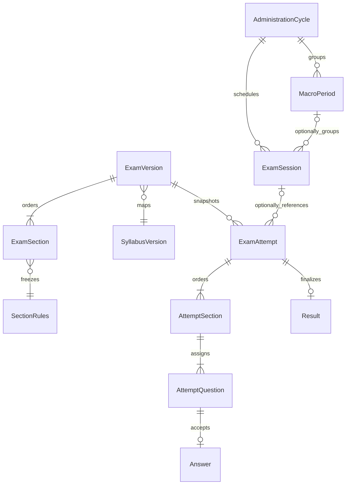

# T1.3 — Target architecture

Date: **2026-11-20**. Proposed technical architecture; no implementation or schema change. Approved requirements and pending policies are controlled by [Phase 1 decisions](PHASE_1_DECISION_REGISTER.md). New Mock Exams, commerce and calendar metadata extend the existing Cent module and Itatest React client. No parallel authentication, CMS, payment, progress or entitlement service is proposed.

## System boundaries and reuse

| Existing Cent/Itatest component | Reuse | Required future change |
| --- | --- | --- |
| CentPractice and immutable AttemptQuestion snapshots | Owner/request identities, question provenance, stored result, idempotent legacy submit | Separate version-aware assembly/state/answer/finalisation handlers; retain legacy handlers untouched |
| CentLearning and curriculum entities | Stable courses/chapters/topics/sources/documents; existing progress/mastery/notes | Add syllabus/release mappings and Reading metadata; do not mutate old mastery denominators silently |
| CentCurriculumImporter/CurriculumIdentity | Existing package/checksum/provenance and stable ID namespace | Reviewed immutable revision manifest/dry-run; replace five-subject/four-option assumptions only in scoped future work |
| CentPayments/CentGateway | Server IRR, order snapshot, user/request locking, verification/events | Quotes/order lines/subject items and contract-dispatched settlement; external-call recovery |
| CentAccess | Resource-to-training ownership/publication checks and legacy grant semantics | Resolve subject benefits/intervals in addition to unchanged old grants |
| CentAdmin/audit | Existing roles and audit concept | Minimal functional definition/review/price/preset controls; broad visual admin Phase 8 remains separate |
| Typed `src/services/cent.ts` and existing React controllers | HTTP/session/error owner, current routing/state | Add new typed contract consumers; retain root/subpath paths and old caches/handlers |
| Existing UI/Fields/Dialog, assessment/reading/commerce layers | Branding, accessibility patterns, theme owner, commerce recovery | Separate functional wiring and visual alignment; no new framework |

`Cent.Module/CentDbContext.cs` and its Cent entities are demonstrably specific and were inspected. Shared-host physical DB fallback is **prior audit evidence**, not freshly inspected host configuration. Shared connection/JWT/subscription/backup/sync/SMS/Myket and all Lerona source are protected. A dependency requiring protected code is a limitation for the later isolated change, never permission to inspect or refactor it.

## Definition and attempt model

Diagram cardinalities describe new versioned Mock Exams; legacy attempts can have no version/sections. Cycle/version applicability is an explicit sourced association, not derived from a year string. Syllabus/version mappings may evolve independently; a published rules release freezes its chosen syllabus/eligibility reference. A self-paced mock's officialSessionId and macroPeriodId are null.

| Concept | Responsibility / immutable content |
| --- | --- |
| ExamVersion | Stable family/version/revision, official provenance and effective applicability; ordered blueprint; scoring/timing/submission policy references |
| ExamSection | Definition identity/order/subject/quota, linked SectionRules; not the existing document-reader CentSection |
| SectionRules | Duration, no carryover/return, warning/advance/timeout semantics; exact boundary revision; optional approved accommodations only through a separate pre-start rules release |
| SyllabusVersion | Immutable official skill mapping/source evidence, independent content release; unknown historical completeness explicit |
| ExamAttempt | Owner/request, format discriminator, complete private rule/content snapshots, status/revision/active pointer, optional cycle/session provenance and approved admission reference |
| AttemptSection | Snapshotted identity/order/quota/duration, state, activation/deadline/effective closure/cause/processed timestamps |
| AttemptQuestion | Existing stable question identity plus frozen revision/presented option order/key/media/topic/group/passage references, position and section; no live-content dependency for scoring |
| Answer | One current accepted option/null per assigned question, durable acknowledged time/revision/command; edits only while its section is active. Optional command ledger retains idempotency, not a device entity |
| Result | Frozen counts/exact quarter-points/ratios, schema/scoring/version/comparison identity, final reason/effective time; officialNormalisedScore=null; no rewrite of old ResultJson |

Editable definitions follow `DRAFT → REVIEWED → PUBLISHED → RETIRED_FOR_NEW_STARTS` as a proposed administrative workflow. Publication validates exact quotas, policies, eligibility, rights and dependency completeness. Published payloads are immutable; corrections fork a revision and activation pointer changes affect future starts only. Reviewed definition status alone does not prove enough eligible content. Retirement never deletes payloads required by running/history readers.

## Runtime responsibilities and atomic boundaries

1. **Configuration resolver** exposes only explicitly available supported rule/content releases. Default activation is explicit; user clock, macro-period rollover and product edits cannot mutate attempts. Pending finalisation/benefit choices must be resolved before activation.
2. **Assembly** validates owner access under approved benefits, exact per-section eligible quotas, unique question revisions and atomic passage groups before committing any timed attempt. Commit complete snapshots and first activation together. Preserve options/key privately; expose only active-section learner content.
3. **Attempt coordinator** serializes commands/reconciliation per attempt using database concurrency/transaction semantics. It captures one server decision time after acquiring state, closes due sections at their effective deadlines and repeatedly activates successors until current. No process-local lock is sufficient across instances.
4. **Answer persistence** durably commits each select/clear and command receipt; acknowledged state is the only saved state. Expected revision and payload-bound idempotency prevent stale writes. UI pending state is informational; no browser-time override.
5. **Transition/finalisation** freezes section answers. Early advancement warns/confirms and forfeits time; timeout auto-advances. Final-section explicit completion yields COMPLETED. Final timeout EXPIRED result policy remains T11-D02. Durable SUBMITTING intent supports one result under crash/retry.
6. **Deadline reconciler** discovers due ACTIVE rows and finalisation intents with indexed reads; it is an aid. Every state read/mutation reconciles too. Offline/worker outage never extends effective deadlines. No new external scheduling product is required.
7. **Result/review projection** returns immutable snapshots only to the owner after terminal finalisation; full raw values, metric denominators, status and limitations are explicit. Historical readers dispatch by original schema; unknown payloads are preserved with a limitation.
8. **Commercial settlement** uses existing provider adapter/owner serialization plus immutable quote/order lines; one paid order creates one aggregate with every subject item atomically. This transaction is separate from exam transitions. Details: [commerce](T1_2_COMMERCE_ARCHITECTURE.md).

The state machine is authoritative in [T1.1](T1_1_SECTION_STATE_MACHINE.md). New Mock Exam outcomes are not fed automatically into current `latest-distinct-10-v2` mastery pending T11-D08. Because current mastery joins all submitted attempts, future implementation must explicitly exclude new mock-contract rows by discriminator; unchanged data semantics for every existing kind remain required. Legacy list/read endpoints likewise must not leak unsupported new result formats into old clients. Legacy results, diagnostics and Practice keep current contracts.

## Question/content and commerce integration

Use the [content model](T1_3_CONTENT_AND_QUESTION_MODEL.md): existing Subject(CentCourse) → Chapter/Topic → existing lessons/materials; additive SyllabusMapping/QuestionRevision/PassageRevision/QuestionGroupRevision/EligibilityRelease. A passage is stored once per immutable revision and once per attempt snapshot reference, not copied into every child. Assembly cannot emit an orphan child. Question difficulty is educational/editorial metadata, not a CISIA coefficient.

Stable subject identity connects offers and entitlements to learning resources. **APPROVED commercial baseline:** all six initial reference prices, including independent Reading and Comprehension, are **490,000 Toman = 4,900,000 canonical integer IRR**. User-facing currency is Toman at IRR/10; storage/provider amounts are integer Rial. Distinct-subject tiers for n=1..6 are 0/5/10/15/20/25%, identical for custom/recommended selections with no added preset discount. Reading has its own subject identity, syllabus/content mappings, standalone offer and independent 12-month entitlement, and may appear in custom/recommended selections. Exact academic presets remain pending P1-C04. A full Mock Exam includes all blueprint sections even if a customer bought a smaller degree bundle. Benefits/admission checks are pending P1-C05/C12. If approved, a bounded attempt admission snapshot lasts only through that attempt's original deadlines; it is not a login session, device permission, or concurrent-study lease. Legacy simulator submission continues its existing subscription check.

## Launch record and grandfathering scope

The owner confirms no registered users, customers, actual buyers or historical customer entitlements requiring grandfathering (APPROVED P1-A12/C09). No customer migration, Reading grandfather grant, compensatory benefit entity or cohort transition workflow is part of launch architecture. This owner confirmation does not certify empty development/test/financial tables; preserve existing records, legacy readers, callbacks and original contract semantics without conversion or deletion. P1-T03 now concerns future Cent deployment/schema/isolation/backup and retained-record evidence, not a customer-grandfathering programme. Exact benefits, rounding/allocation, expiry/renewal, refunds, quote/checkout behavior and mid-attempt expiry remain pending. The earlier 490,000 IRR interpretation and cohort-dependent Reading proposal are explicitly superseded.

## Calendar architecture

| Record | Required fields and separation |
| --- | --- |
| AdministrationCycle | Sourced start/end-inclusive dates; academic-year association separately evidenced |
| MacroPeriod | Cycle, ordinal, month windows, source evidence; no fabricated exam dates |
| ExamSession | Cycle/version applicability, optional macro-period, organizer/university, HOME/UNI format, local date, nullable exact start, Europe/Rome timezone, status/evidence |
| RegistrationPeriod | Session reference, nullable announced open/close instants and timezone, official link; unknown is not a calculated weekday deadline |
| ResultPublication | Macro-period/session scope, date/precision, source wording, whether year is inferred, conflict/verification status; not a session date |
| SourceReference | URL, document date or unknown, effective scope, retrieval time, verified claims, conflicts, reviewer |

Verification states: `confirmed`, `inferred`, `unannounced`, `conflicting`, `stale`, `withdrawn`. Store a nullable date with precision (`instant`, `date`, `month_day`, `month_window`) and original wording; do not coerce date-only data to midnight. Preserve Europe/Rome DST context; display Tehran conversion only for a known instant. Unknown start times remain unknown. Define refresh responsibility/freshness before publishing calendar UI (P1-T04); existing Phase 0 session observations are dated historical evidence, not newly verified live availability. No invented new sessions, seats, booking or result scheduler.

Current macro-windows Nov–Jan, Feb–Mar, Apr–May, Jun–Jul, Aug–Sep are confirmed; October's absence from those windows is not a sixth window. Structure page publication month/day statements and old/general regulation wording conflict; both stay sourced. Itatest mocks do not enforce official one-sitting-per-macro-period booking rules. Personal study planning/reminders are optional unapproved capabilities; define no planner/device/session entities in this phase.

## Nonfunctional acceptance and review limits

Owner isolation, no-store/private attempt/result responses, no active answer-key leak, checked exact arithmetic, stable idempotency, deadline catch-up, atomic settlement and compatible readers are required technical properties. Logs should correlate internal IDs/reasons without tokens, raw provider bodies or private answers. Numeric latency/capacity targets, retention duration, operational RPO/RTO and live provider guarantees are unknown and require a later bounded operations review. Do not infer production readiness from this design.

Contracts: [API](T1_3_API_CONTRACTS.md), [migration/rollback](T1_3_DATABASE_MIGRATION_STRATEGY.md), [risks](PHASE_1_RISK_REGISTER.md). Next-phase work needs explicit authorization, applicable product decisions, operator evidence and clone validation. No Phase 2 task has started.
